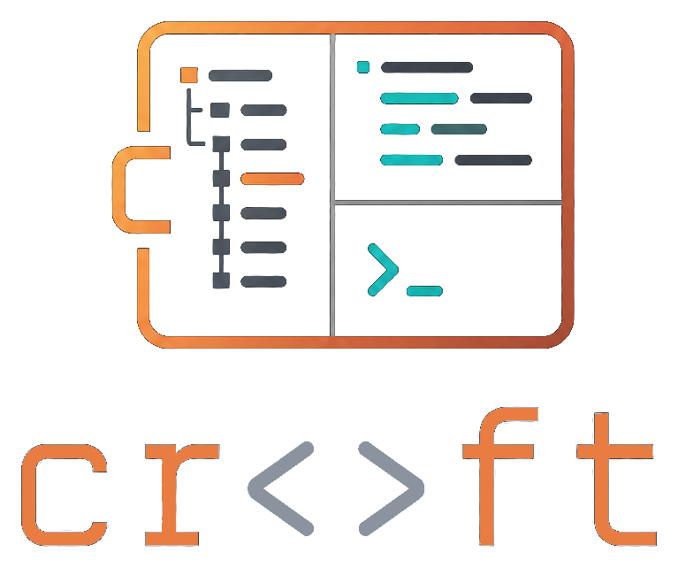

<div align="center">
  
</div>

# croft for Windows

A native Windows port of **[croft](https://github.com/vitali87/croft)** — the VS Code style
three pane workspace that runs entirely inside your terminal, written in Rust and shipped as a
single binary.

This repository is a fork of [`vitali87/croft`](https://github.com/vitali87/croft). All credit for
the editor, terminal, Source Control, test runner and debugging experience belongs to the upstream
project and its authors; this fork adds the layer needed to build and run that same code as a
first-class `x86_64-pc-windows-msvc` binary instead of only as a Linux build under WSL2.


## Upstream and this port

| | Upstream [`vitali87/croft`](https://github.com/vitali87/croft) | This fork |
|---|---|---|
| Targets | macOS, Linux, Android (Termux) | Those, plus **Windows 10/11 x86_64** |
| Windows story | Run the Linux build inside WSL2 | Native `croft.exe`: ConPTY, PowerShell, Win32 clipboard, Windows toolchains |
| Install | Homebrew, `cargo binstall`, releases, source | Build from source in this repository |

Everything documented in the upstream README still applies unless a section below says otherwise.

## What the Windows port adds

The port keeps `#[cfg(unix)]` behaviour intact and routes every OS-specific call through a new
`src/platform/` layer, so the same source tree builds for Windows without a second codebase:

* **Platform layer** (`src/platform/`): environment and `PATH` lookup with `.exe`/`.cmd`/`.bat`
  resolution, filesystem helpers, process control, time, hostname, and IPC. `unsafe` Win32 FFI is
  confined to this module.
* **Terminal:** ConPTY-backed panes, PowerShell 7+ (`pwsh.exe`) and Windows PowerShell 5.1
  (`powershell.exe`) as first-class shells, plus `cmd.exe`, Git Bash and `wsl.exe` profiles. A
  PowerShell [shell integration script](docs/WINDOWS.md) emits `OSC 133` prompt/command marks and
  `OSC 7` working-directory reports, which gives you prompt navigation, command timing, and correct
  pane working directories without POSIX `tcgetpgrp`.
* **Tasks:** shell-aware quoting, so the zero-config task runner emits valid PowerShell
  (`Push-Location` / `$env:KEY = ...`) or `cmd.exe` syntax instead of POSIX `cd ... && export ...`.
* **Processes:** Win32 Job Objects for process-tree kill, so stopping a task, run or debug session
  takes its children with it.
* **Clipboard:** native `CF_UNICODETEXT` copy and paste.
* **Language servers:** Windows discovery and provisioning (`rust-analyzer`, `taplo`, `clangd`,
  `marksman`, `csvlens`), including `uv.exe`, Node and `npm.cmd` bootstrapping.
* **Debugging:** Python virtual environments resolved at `Scripts\python.exe`, `dlv.exe` and
  `tsc.cmd` discovery, and `lldb-dap.exe` support for Rust, C and C++.
* **Remote:** `croft remote <host>` and `croft sync-config` over the built-in Windows OpenSSH
  client.
* **Host terminal probe:** a Win32 console capability query for Sixel, the Kitty keyboard protocol,
  and cell pixel geometry, so images and icons size correctly in Windows Terminal 1.22+ and WezTerm.
* **NTFS save hardening:** atomic writes and renames retry through transient `ERROR_ACCESS_DENIED` /
  `ERROR_SHARING_VIOLATION` from Defender, the Search Indexer, or a language server holding a handle.
* **Local IPC and links:** `croft view`, `croft edit --wait`, `croft hook` (Claude Code pre-tool
  approvals) and `croft://` deep links, implemented on capability-token-authenticated loopback TCP
  plus an `HKCU\Software\Classes\croft` handler — no admin rights required.

## Windows limitations

The port targets a native, single-user, local-first workflow. Features built on POSIX daemons and
OpenSSH `ControlMaster` sockets are not available in the native build and remain WSL2 territory:
`croft attach`, `croft ls`, `croft record`, `croft web`, `croft pair`, `croft collab`,
`croft devcontainer`, and the pane/session host internals behind them. Use the Linux build under
WSL2 for those.

The full internal test suite is not yet ported: `tests/platform` runs on Windows, while the broader
`cargo test --bin croft` suite still carries Unix-only tests, and Windows CI is not wired up. Treat
this fork as usable-but-young rather than release-hardened. The work item list and per-area status
live in [Windows_Port.md](Windows_Port.md).

## Requirements

| Requirement | Why |
|-------------|-----|
| Windows 10/11 on x86_64 | The port targets `x86_64-pc-windows-msvc`. |
| PowerShell 7+ or Windows PowerShell 5.1 | Default shell pane and shell integration. `cmd.exe` also works, with reduced integration. |
| Windows Terminal or WezTerm | Sixel / OSC 1337 graphics for icons and inline image, PDF and spreadsheet previews. Legacy `conhost.exe` falls back to the image-less text UI. |
| A Nerd Font as your terminal font | File and activity-bar icons are Nerd Font glyphs; without one they render as `[?]` boxes. |
| A Rust toolchain (1.97+, edition 2024) | Building from source. Prebuilt Windows binaries are not published by this fork. |
| Microsoft C++ Build Tools | Required by the MSVC target if you do not already have a configured Rust MSVC toolchain. |

Setup details — Nerd Font, terminal keybindings, optional previews — are in
**[docs/WINDOWS.md](docs/WINDOWS.md)**.

## Build and install

From this repository:

```powershell
cargo install --path . --locked
```

Or build a release binary without installing:

```powershell
cargo build --release
.\target\release\croft.exe
```

`cargo install` puts `croft.exe` in `%USERPROFILE%\.cargo\bin`, which is on `PATH` by default.

## Run

`croft` opens the current directory and `croft <folder>` any other. `croft remote <host>` connects
to a Linux server over SSH, installing itself there on first connect.

See [docs/CLI.md](docs/CLI.md) for the commands used most; `croft --help` lists them all.

## Tenets

The non-negotiables behind every decision in croft, unchanged from upstream:

1. **croft starts in milliseconds. No exceptions.**
2. **Speed is a must.**
3. **Low latency is non-negotiable.**
4. **Local and remote parity always binds.**
5. **The gap between terminal and GUI stays minimal.**
6. **Everything has a shortcut.**
7. **Correctness beats workarounds.**
8. **One binary for the core; extensions arrive in one click.**

See [docs/TENETS.md](docs/TENETS.md) for what each one means in practice.

## Layout

The upstream layout is unchanged: an Explorer sidebar, a code editor, and a terminal panel in the
VS Code arrangement, with an activity bar switching the sidebar between Explorer, Search, Source
Control, Remote (SSH), Run and Debug, Extensions, and Testing. LSP completion, hover,
go-to-definition, rename, quick fixes and inlay hints, tree-sitter highlighting, multi-cursor, the
minimap, git gutter, inline blame, the optional vim mode, hunk staging, the commit graph, the Test
Explorer, the task runner and Live Run are all present on Windows.

See [docs/LAYOUT.md](docs/LAYOUT.md) for the pane-by-pane reference.

## Keybindings

Press `F1` inside croft for the full reference; the complete tables live in
[docs/KEYBINDINGS.md](docs/KEYBINDINGS.md). The command modifier on Windows is `Ctrl`, as on
Linux. `Ctrl` chords that the host terminal or Windows itself reserves may need remapping; see
[docs/WINDOWS.md](docs/WINDOWS.md).

## Contributing

All changes here are meant to stay mergeable upstream: platform differences belong behind
`src/platform/` or a `cfg(windows)` arm, never in a parallel implementation of a feature.

Read [CONTRIBUTING.md](CONTRIBUTING.md) for the developer workflow and
[docs/ARCHITECTURE.md](docs/ARCHITECTURE.md) for the project layout and internals. For the port
itself, start with [Windows_Port.md](Windows_Port.md).

## License

MIT, as upstream. See [LICENSE](LICENSE).
